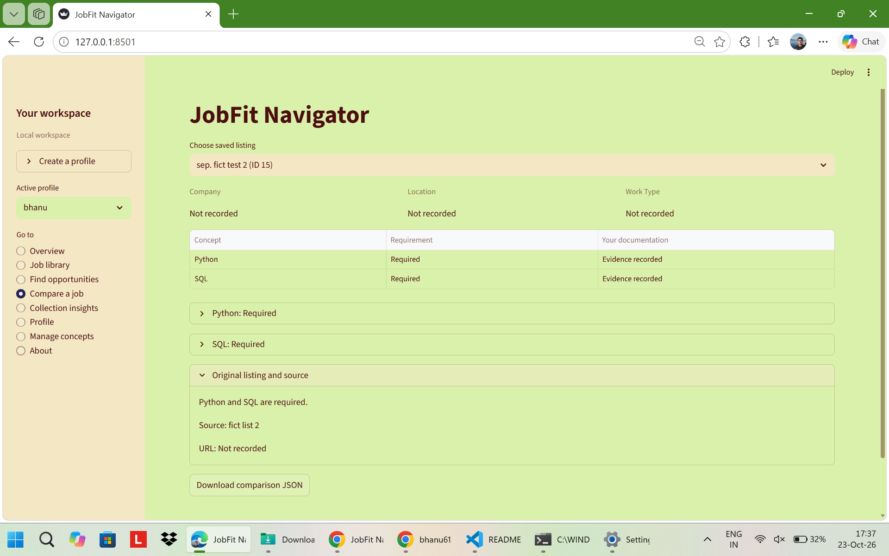
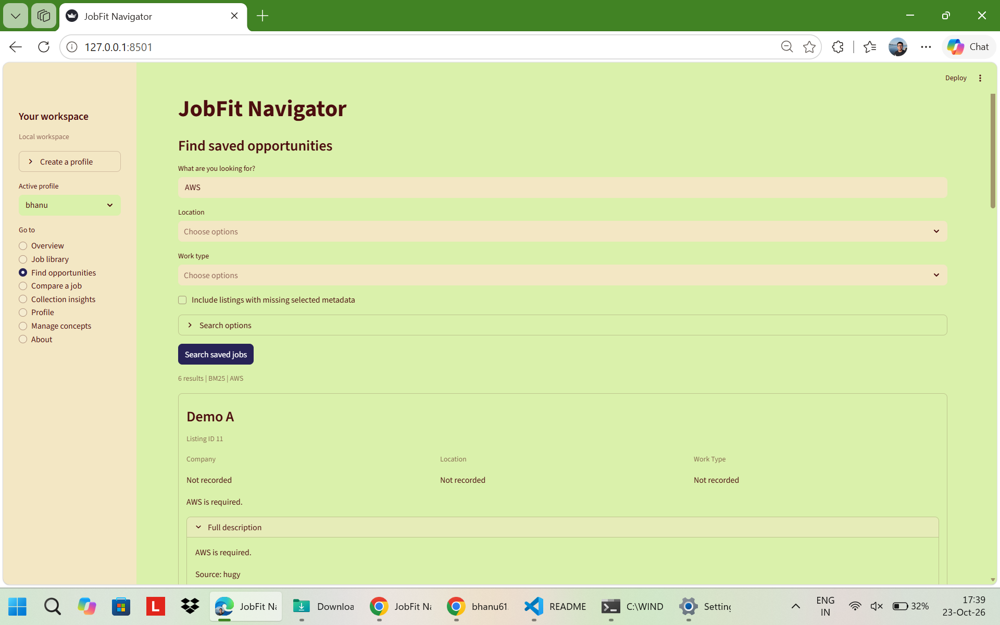
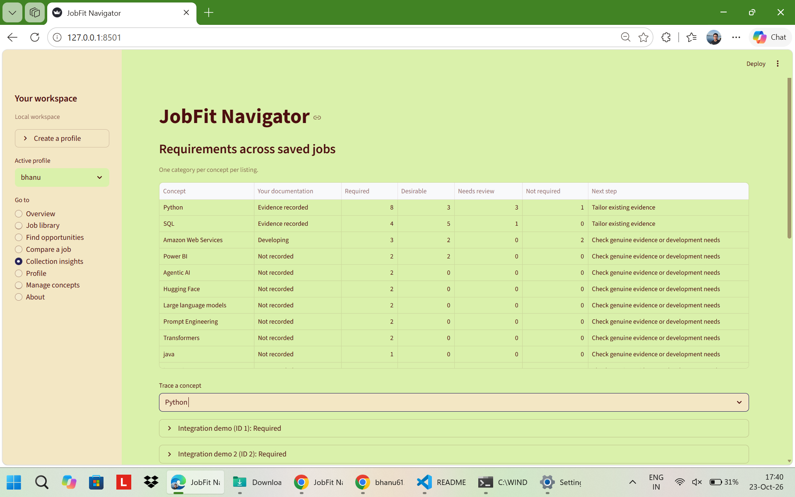

# JobFit Navigator

A Python application for organising job listings, reviewing their requirements and searching a saved collection. It brings the original listing text, profile notes and requirement evidence into one workspace.

## Live demo

[Open JobFit Navigator](https://jobfit-navigator.streamlit.app/)

The online demo uses fictional data in a temporary workspace. It is not intended for storing personal data permanently.

## What you can do

- Save and edit listings with company, location, work type and application status.
- Inspect required, desirable and not-required concepts alongside the original wording.
- Add concepts and aliases, preview their matches and retire ambiguous aliases.
- Save interpretation reviews with reasons and compare requirements with profile evidence.
- Record language statements and inspect language requirements.
- Search saved listings using BM25, semantic or hybrid search.
- Filter by location and work type, or browse without a text query.
- Explore requirement counts across listings and trace them back to source text.
- Export metadata, comparisons and profile records, and download a workspace backup.

## Screenshots

Examples from a local run with test listings.

### Job comparison

View job requirements alongside profile notes and the original listing.



### Search

Search saved listings with BM25 keywords or semantic search.



### Collection insights

See which requirements appear across saved jobs and trace them back
to individual listings.



[View all screenshots](docs/SCREENSHOTS.md)

## How it works

The application detects concept names and aliases, applies contextual rules to requirement wording and links each interpretation to its source. Saved reviews are tied to the listing text.

Search combines a BM25 keyword baseline with passage embeddings from a pretrained multilingual Sentence Transformers model. Hybrid search merges the two rankings.

The interface uses Streamlit, with SQLite for storage. Local mode keeps a persistent workspace. Demo mode starts with temporary fictional data.

See [Architecture](docs/ARCHITECTURE.md) for the implementation and [Limitations](docs/LIMITATIONS.md) for interpretation and evaluation details.

## Run locally on Windows

Install Python 3.11 or 3.12, then:

1. Double-click `Setup-Local.cmd` and complete the workspace prompt.
2. Double-click `Start-Local.cmd`.

The first semantic search downloads the pretrained model and requires internet access.

## Run a demo in PowerShell

```powershell
python -m venv .venv
.\.venv\Scripts\python.exe -m pip install -r requirements.txt
.\.venv\Scripts\python.exe -m streamlit run app.py
```

The demo uses fictional session data. Use the local launcher for a persistent workspace.

## Testing

```powershell
python -m unittest discover -s tests -v
```

All 64 automated tests passed on Windows with Python 3.12. Manual checks also covered sidebar navigation, requirement interpretation for a fictional listing and a real semantic search.

## Project layout

- `app.py`: Streamlit interface
- `launch.py`: persistent local startup
- `jobfit/`: storage, concept matching, interpretation, reviews and retrieval
- `tests/`: backend, packaging and interface tests
- `tools/`: workspace import and source-update helpers
- `docs/`: architecture and limitations
