# JobFit Navigator screenshot gallery

Local interface captures from 23 October 2026.

These screenshots show a development workspace containing demonstration
and test listings. The Overview capture records 22 saved opportunities
and 7 skill statements for the active profile.

Most captures use the `bhanu` profile; the final two use `test`.
Profile notes and language levels are user-reported. Listing metadata
is demonstration input, not verified employer information.

The screenshots show individual application behaviours, not an
independent accuracy benchmark or candidate suitability assessment.
Theme colours vary between captures.

[Back to the project README](../README.md)

## Job comparison

### Coordinated requirements

The listing `sep. fict test 2` contains “Python and SQL are required.”
Both concepts appear as Required, separately from their profile
documentation status.

### Mixed requirement wording

The listing `fict listing 4` contains both “Python is required” and
“Python is desirable.” Its concept-level category is Needs review
rather than silently choosing one interpretation.

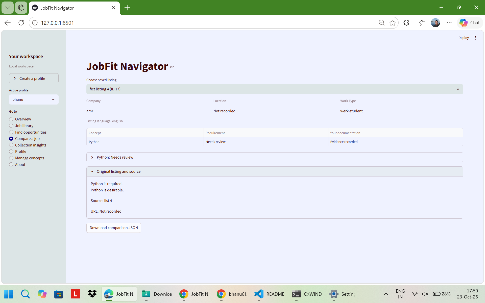

### Second profile and explicit negation

This capture uses the `test` profile. Python is Required, SQL is
Desirable, and Docker is Not required. Docker nevertheless has an
evidence statement in this profile: requirement categories and
profile documentation are separate.

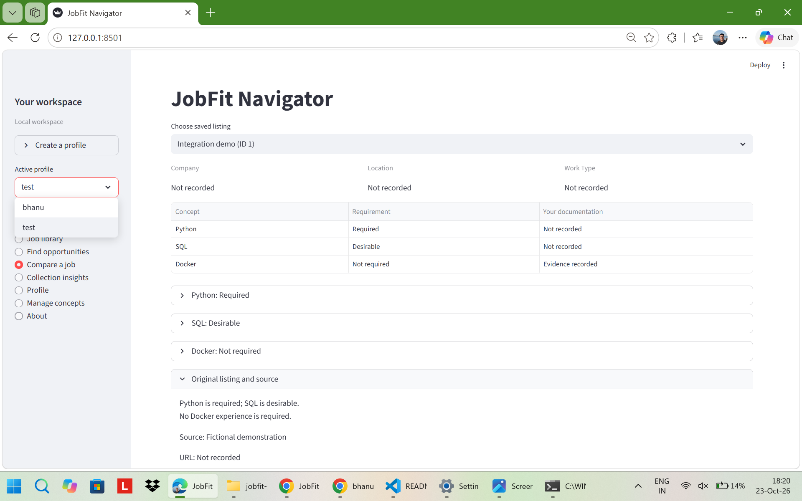

### Language-only requirements

This listing states “German B2 is required” and “English is desirable.”
The interface shows German as Required and English as Desirable,
with no technical concepts detected.

This is a display of language requirement wording, not verification
of a candidate's proficiency or an automatic language eligibility decision.

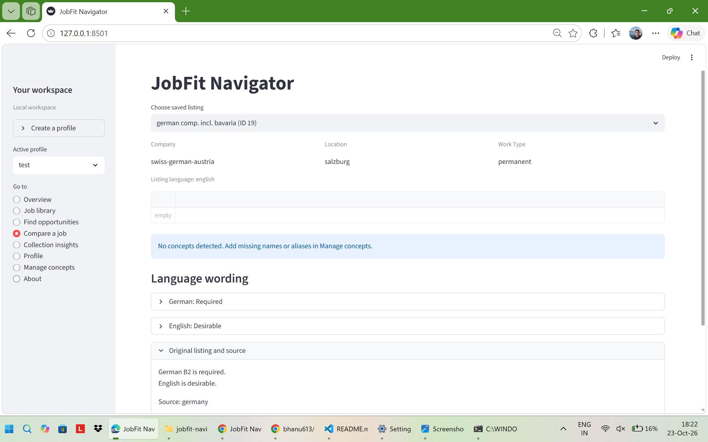

## Keyword search

### AWS query

The submitted BM25 query `AWS` returns six saved listings in this
workspace. The top visible result is `Demo A`.

### Matching words and negated wording

The explanation shows the matched word `aws`. Results also include
a listing containing “AWS is not required”: keyword retrieval does
not decide whether a matched concept is mandatory.

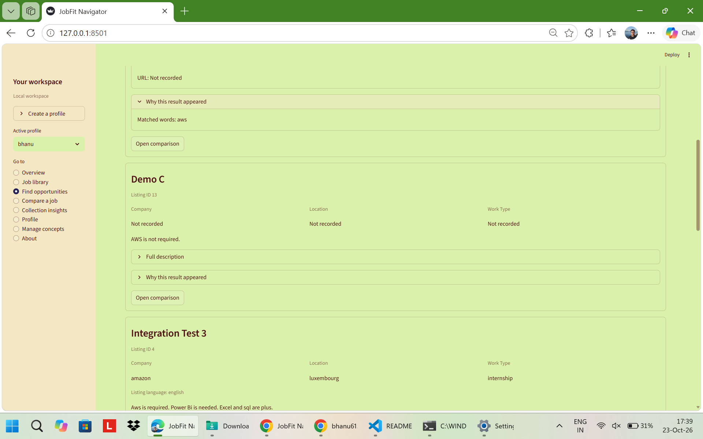

### Language keyword query

The BM25 query `german` returns a saved listing containing the
German and English requirement statements.

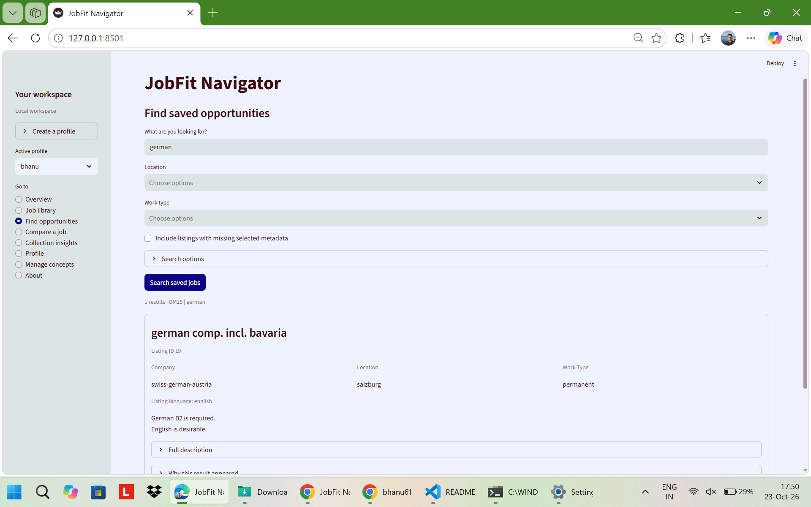

## Semantic search

### Submitted semantic query

Semantic mode returns ten results for the query `transformer`.
This capture records a completed search in the local run; it does
not establish retrieval accuracy or superiority over BM25.

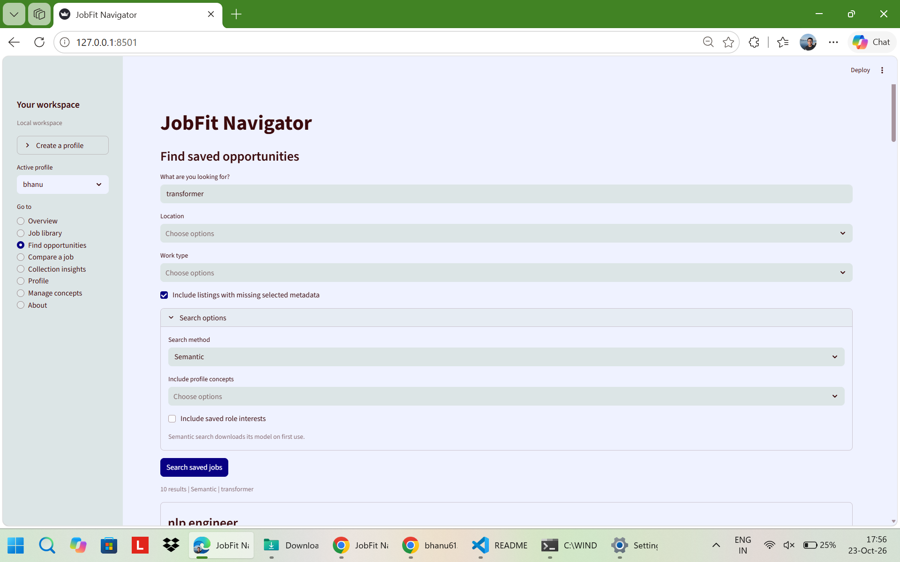

### Returned listing cards

The visible results include `nlp engineer` and `AI Engineer`, with
their saved listing text and metadata.

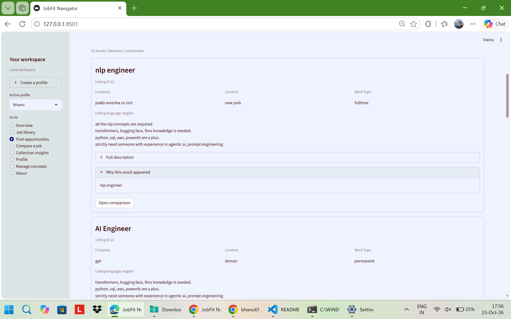

## Metadata filtering

### Browse by location

With the text query empty and `trier` selected as the location,
the interface returns one listing in Browse mode.

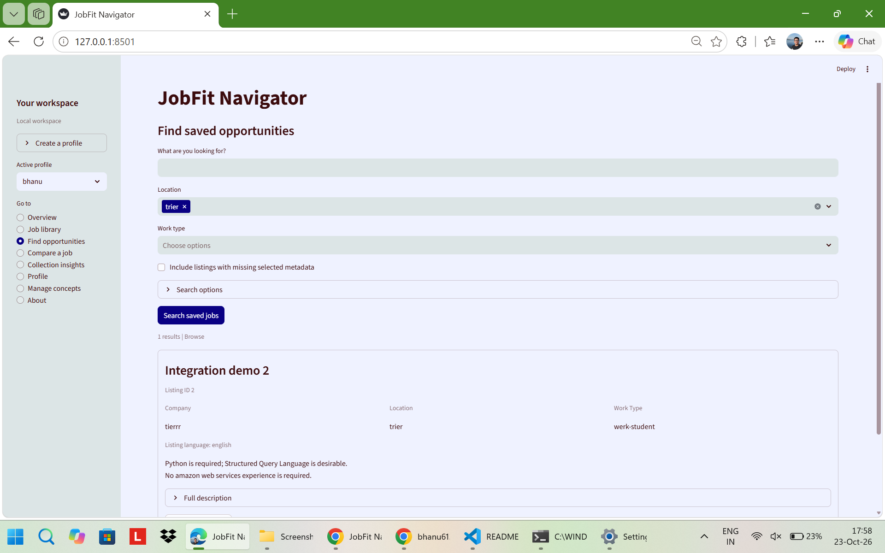

## Collection insights

### Requirement categories and documentation

The table groups detected concepts into Required, Desirable,
Needs review and Not required categories across saved listings.
Profile documentation and next-step guidance appear alongside
those counts.

These are collection-level observations, not labour-market demand
statistics or skill-proficiency scores.

### Listing traces and language totals

The collection view links Python categories to individual saved
listings and displays aggregated language requirement categories.

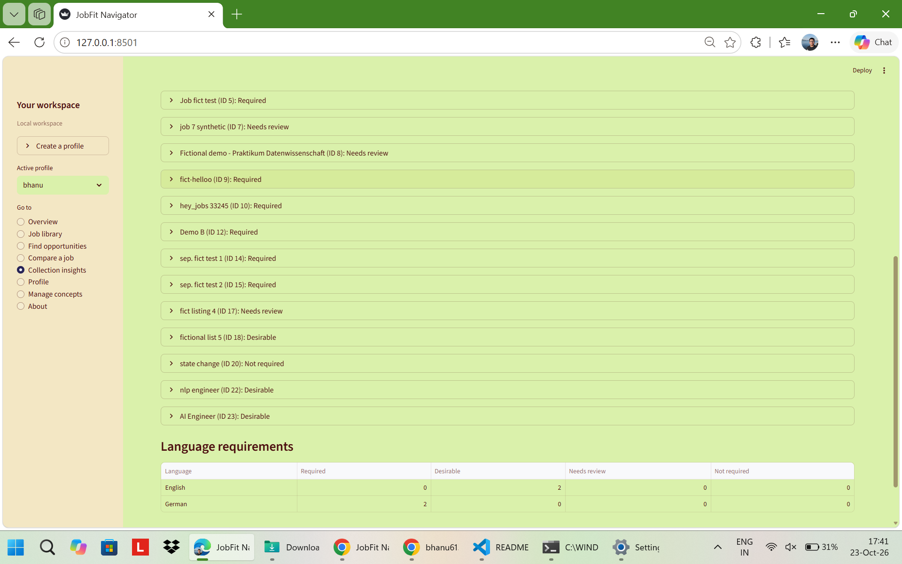

### Additional concepts and SQL traces

Additional rows show optional preparation, concepts found only in
not-required wording, and wording that needs review. The SQL trace
connects its categories to saved listings.

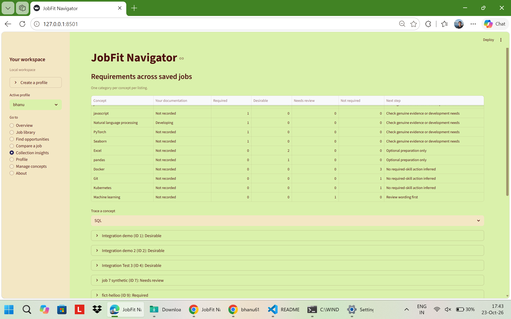

## Job library

### Recent listings

The library displays saved listing IDs, titles, application statuses,
company, location, work type and source. The selected record shows
its original requirement text.

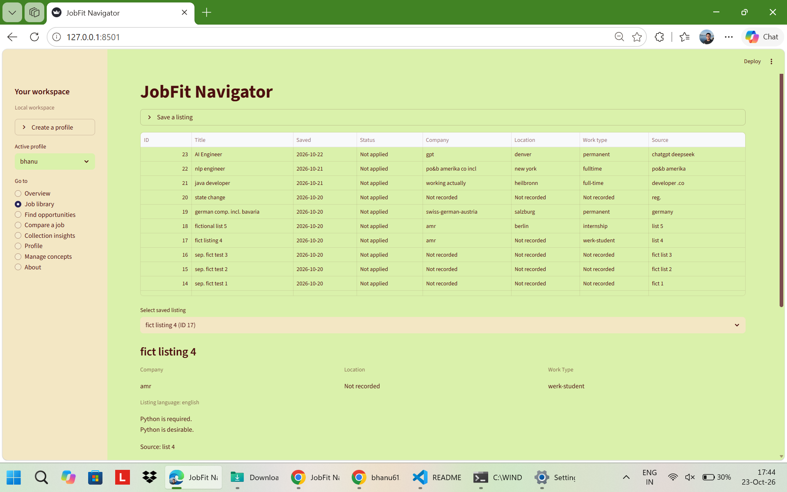

### Listing details

The selected `AI Engineer` record shows the saved description,
including required knowledge, desirable concepts and request wording.

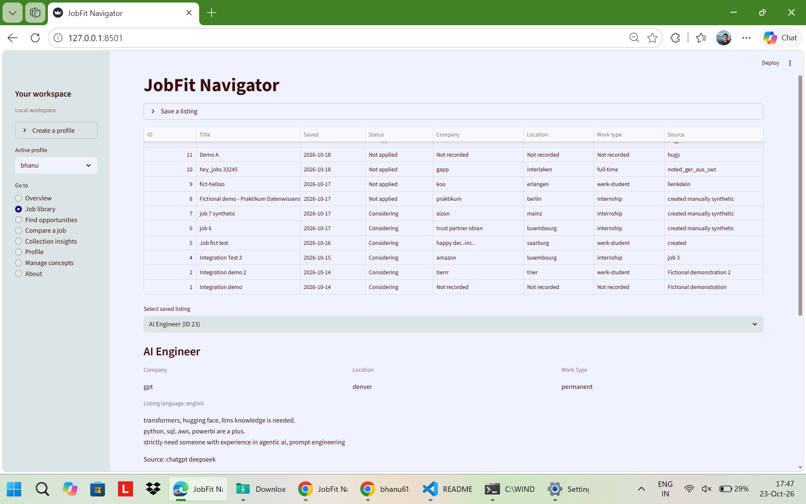

## Overview and profile

### Workspace overview

The overview records 22 saved opportunities and 7 profile statements,
with required concepts that may need further documentation.

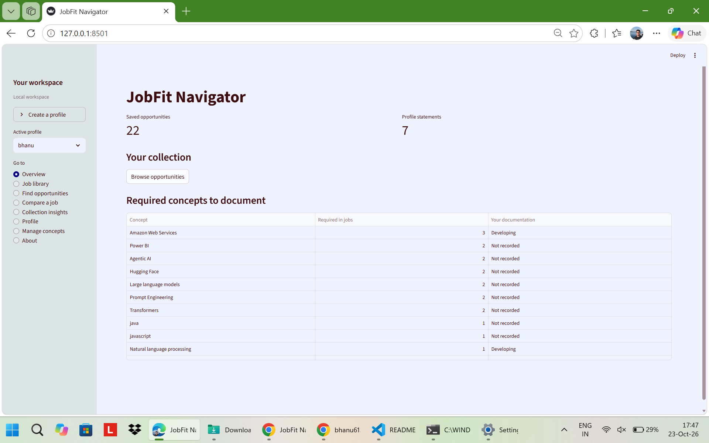

### Skill statements and evidence

The profile stores concept-specific documentation statuses and notes,
including evidenced, developing and self-reported statements.
These are user-entered records, not independently verified abilities.

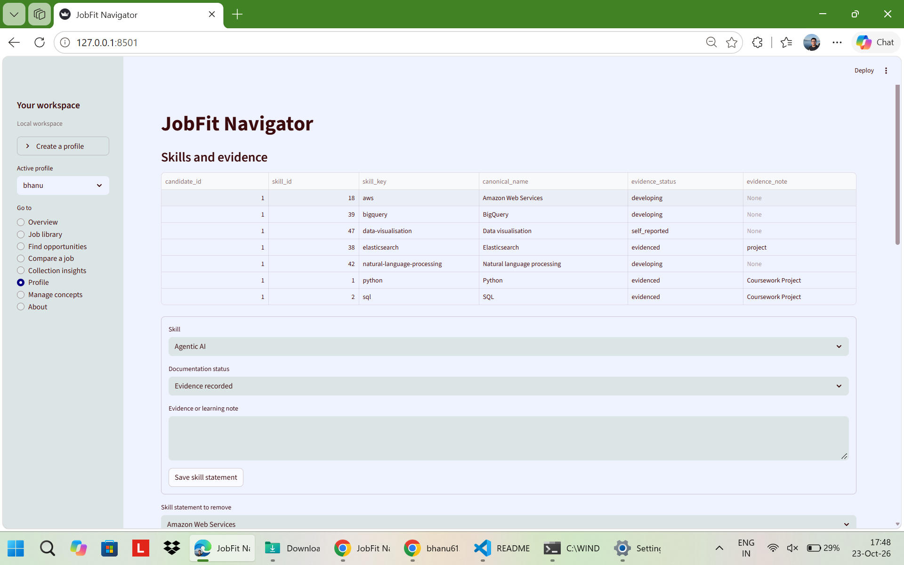

### Preferences and language statements

The profile also stores role interests, preferred locations,
work types and self-reported language statements.

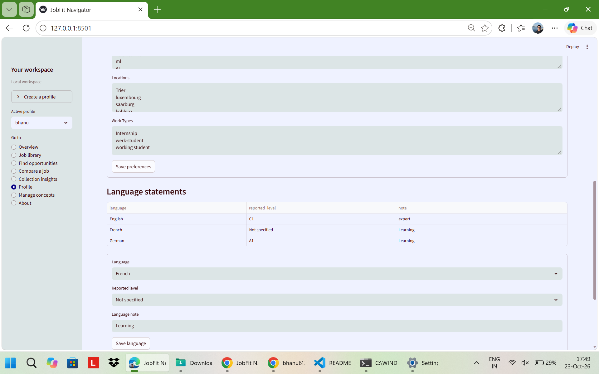

## Scope

Screenshots document the displayed local state at capture time.
Results and counts can change when saved listings, concepts,
reviews or profile statements change.

Requirement interpretation is distinct from retrieval ranking.
Missing profile documentation does not establish missing ability,
and a retrieved listing is not an eligibility recommendation.

See [architecture](ARCHITECTURE.md) and
[limitations](LIMITATIONS.md) for implementation details and boundaries.

[Back to the project README](../README.md)